# Activité pratique 2 – Application de facturation en micro-services

**Objectif :** créer une application basée sur une architecture micro-services qui permet de gérer des factures contenant des produits et appartenant à un client.

## Architecture

| Module | Port | Rôle |
|---|---|---|
| `customer-service` | 8081 | Gestion des clients (Spring Data REST, H2 `customers-db`) |
| `inventory-service` | 8082 | Gestion des produits (Spring Data REST, H2 `products-db`) |
| `billing-service` | 8083 | Gestion des factures, appelle les deux services via OpenFeign, circuit breaker Resilience4J |
| `gateway-service` | 8888 | Spring Cloud Gateway : routage statique puis dynamique |
| `discovery-service` | 8761 | Eureka Server |
| `config-service` | 9999 | Spring Cloud Config Server (dépôt Git `ecom-config-repo`) |
| `ecom-client` | 4200 | Client Angular (clients, produits, facture) |

Technologies : Java 21, Spring Boot 4.1, Spring Cloud, Spring Data REST, H2, Lombok, OpenFeign, Resilience4J, Angular.

## Ordre de démarrage

1. `discovery-service`
2. `config-service`
3. `customer-service`, `inventory-service`
4. `billing-service`
5. `gateway-service`
6. `ecom-client` : `cd ecom-client && ng serve`

## Travail réalisé

1. **customer-service** : entité `Customer`, repository Spring Data REST, données de test.
2. **inventory-service** : entité `Product`, repository Spring Data REST, données de test.
3. **gateway-service** : création du module.
4. **Routage statique** : routes `/customers/**` et `/products/**` dans `application.yml`.
5. **Eureka** : `discovery-service`, enregistrement des services, routes `lb://`.
6. **Routage dynamique** : `DiscoveryClientRouteDefinitionLocator` (`/NOM-DU-SERVICE/**`).
7. **billing-service** : entités `Bill` et `ProductItem`, clients OpenFeign, `GET /bills/{id}`, circuit breaker avec méthodes de repli.
8. **config-service** : configuration centralisée dans un dépôt Git séparé, `@RefreshScope` et `/actuator/refresh`.
9. **Client Angular** : pages clients, produits et facture, via la gateway.

## Captures d'écran

| Étape | Capture |
|---|---|
| 1 – customer-service | `http://localhost:8081/customers` |
| 2 – inventory-service | 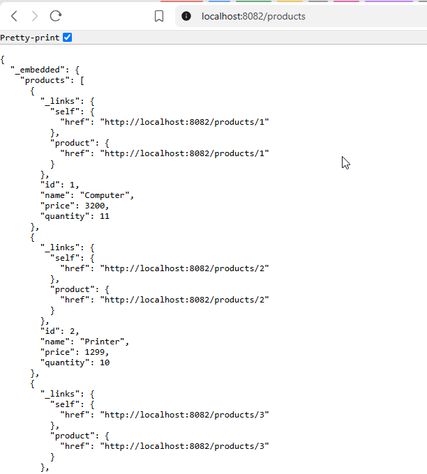 |
| 4 – routage statique, clients | 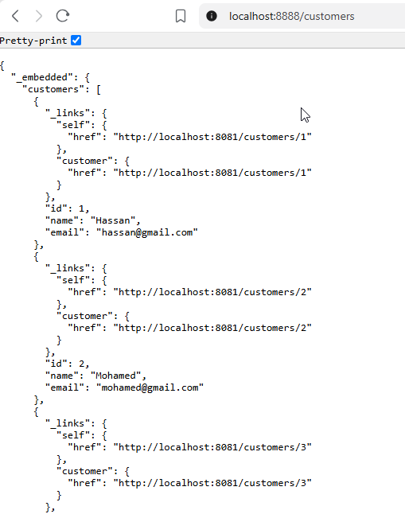 |
| 4 – routage statique, produits | 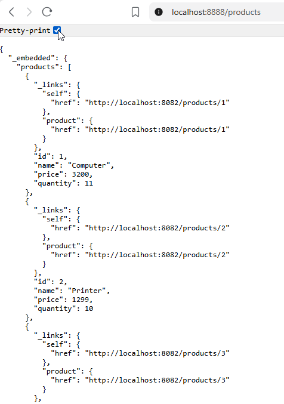 |
| 5 – Eureka | 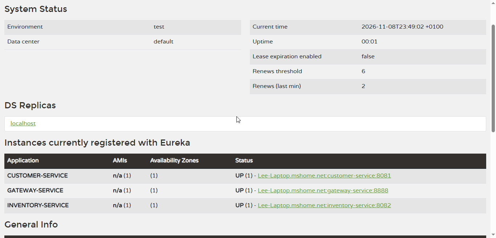 |
| 6 – routage dynamique, clients | 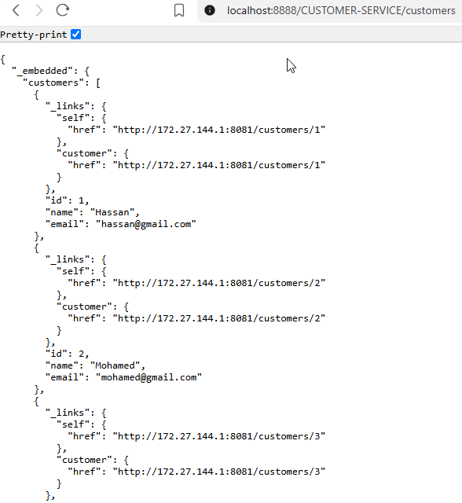 |
| 6 – routage dynamique, produits | 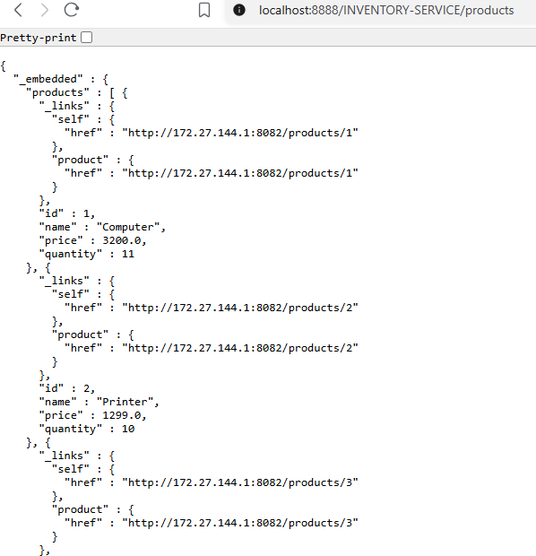 |
| 7 – facture via billing-service | 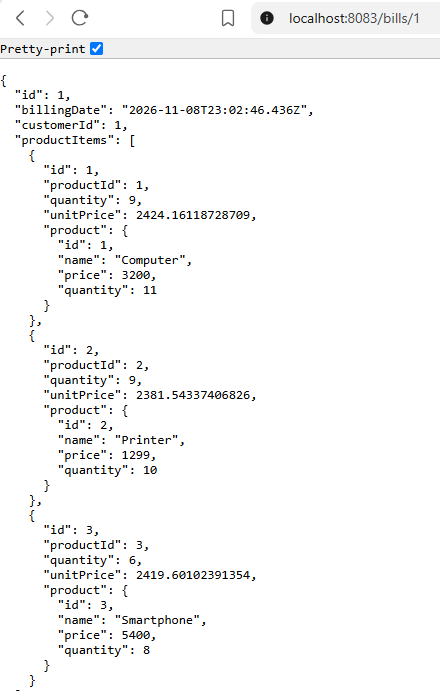 |
| 7 – facture via la gateway | 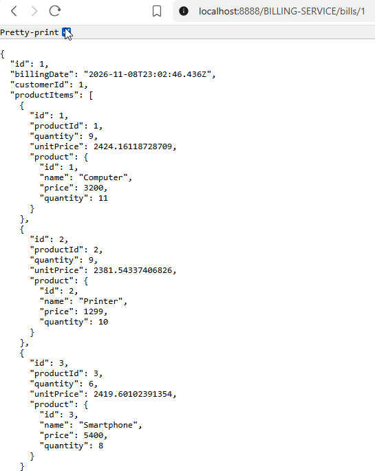 |
| 7 – circuit breaker (client indisponible) | 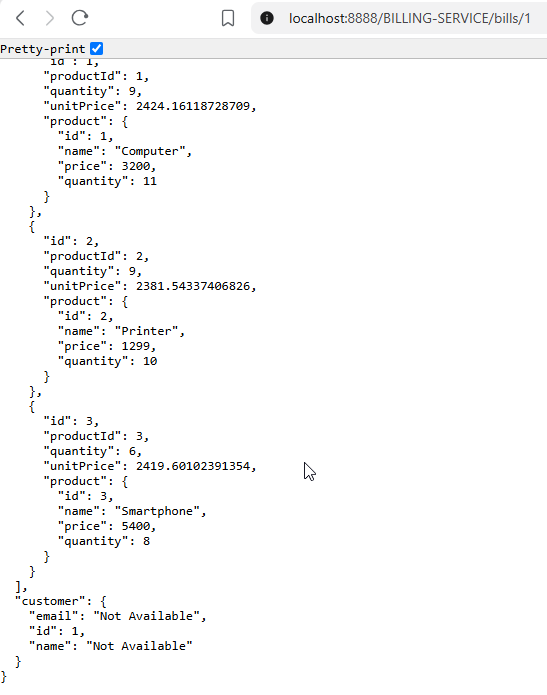 |
| 8 – config server (x=10) | 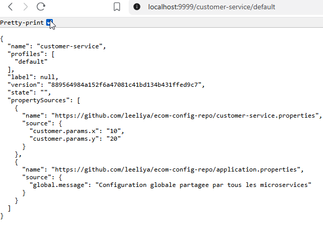 |
| 8 – `/params` du customer-service | 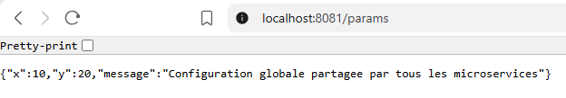 |
| 8 – config server après modification (x=70) | 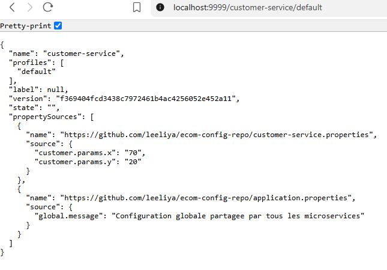 |
| 9 – client Angular, liste des clients | 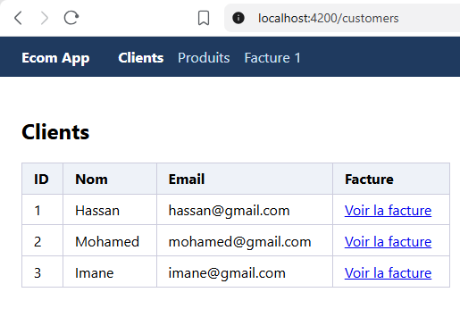 |
| 9 – client Angular, détail d'une facture | 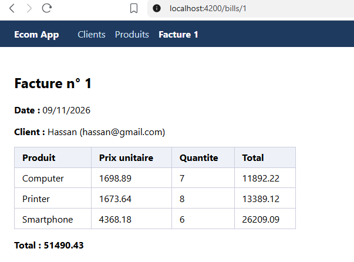 |
